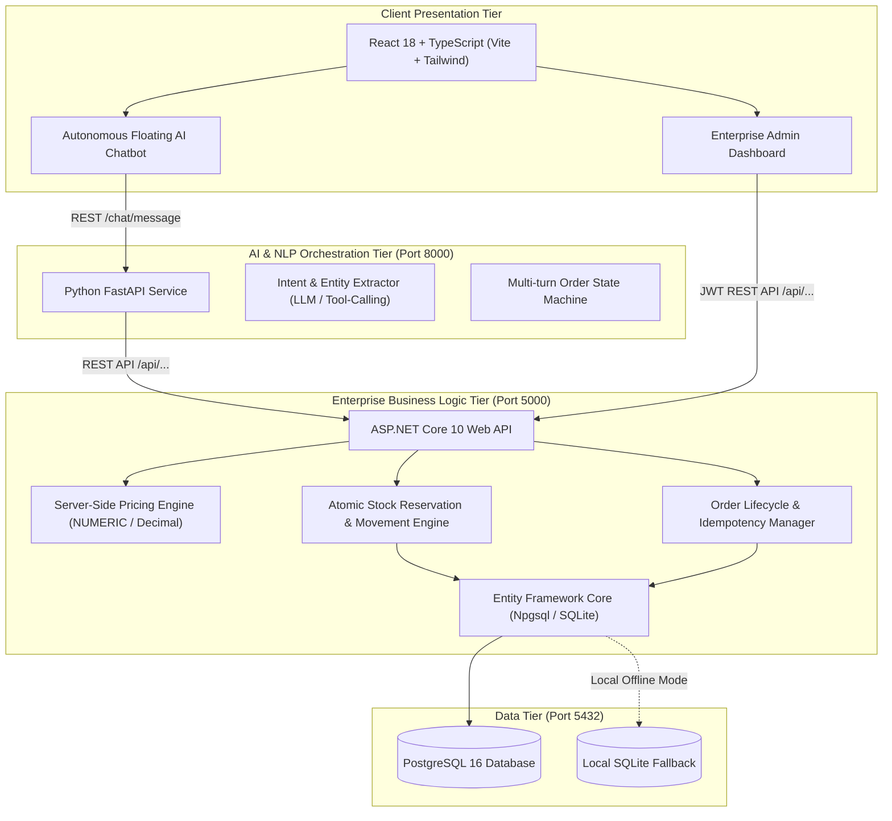

# Apex Inventory & AI-Powered Order Management System

A production-ready enterprise web application that integrates an autonomous AI sales assistant with an inventory management and order fulfillment engine. Built with **React 18 + TypeScript**, **ASP.NET Core Web API (.NET 10)**, **Python FastAPI**, and **PostgreSQL** (with dual-provider local SQLite fallback).

---

## 1. System Architecture



> [!IMPORTANT]
> **Strict Separation of Concerns**: The AI chatbot service **never connects directly to the database**. All product lookups, stock checks, pricing calculations, reservations, and order placements are delegated to validated backend REST APIs.

---

## 2. Inventory Invariant & Mathematical Model

All inventory calculations strictly enforce the mathematical invariant:

$$\text{Available to Sell} = \text{On-Hand Stock} - \text{Reserved Stock}$$

### Order Lifecycle State Transitions:
1. **Order Creation (`Draft` / `Confirmed`)**:
   - The pricing engine validates unit prices and tax rates directly from server configuration.
   - An atomic database transaction verifies `Available Stock >= Quantity Requested`.
   - The requested units are **reserved**:
     $$\text{Reserved}_{\text{new}} = \text{Reserved}_{\text{old}} + \text{Quantity}$$
     $$\text{Available}_{\text{new}} = \text{On-Hand} - \text{Reserved}_{\text{new}}$$
2. **Order Dispatch (`Dispatched`)**:
   - Fulfills the reservation by deducting physical on-hand stock:
     $$\text{On-Hand}_{\text{new}} = \text{On-Hand}_{\text{old}} - \text{Quantity}$$
     $$\text{Reserved}_{\text{new}} = \text{Reserved}_{\text{old}} - \text{Quantity}$$
     $$\text{Available}_{\text{new}} = \text{On-Hand}_{\text{new}} - \text{Reserved}_{\text{new}}$$
3. **Order Cancellation (`Cancelled`)**:
   - If cancelled before dispatch, the reserved units are released back to available stock:
     $$\text{Reserved}_{\text{new}} = \text{Reserved}_{\text{old}} - \text{Quantity}$$
   - Orders already in `Dispatched` or `Delivered` status cannot be cancelled directly; they must undergo formal return processing.

---

## 3. Technology Stack

| Layer | Technologies & Packages |
|---|---|
| **Frontend** | React 18, TypeScript, Vite, Tailwind CSS, Lucide React |
| **Backend API** | C# .NET 10, ASP.NET Core Web API, EF Core 10, Npgsql, Microsoft.Data.Sqlite, Swashbuckle OpenAPI 10, BCrypt.Net-Next, System.IdentityModel.Tokens.Jwt |
| **AI / Chatbot** | Python 3.12, FastAPI, Uvicorn, Pydantic v2, HTTPX, OpenAI SDK (tool-calling compatible) |
| **Database** | PostgreSQL 16 (production), SQLite 3 (local development fallback) |
| **DevOps** | Docker, Docker Compose multi-stage builds, Nginx alpine |

---

## 4. Quick Start: Docker Compose

To start all services with a single command:

```bash
# From project root:
docker-compose up -d --build
```

### Exposed Endpoints:
- **Frontend SPA**: [http://localhost:3000](http://localhost:3000)
- **.NET Web API (Swagger UI)**: [http://localhost:5000/swagger](http://localhost:5000/swagger)
- **FastAPI Chatbot (OpenAPI Docs)**: [http://localhost:8000/docs](http://localhost:8000/docs)
- **PostgreSQL Database**: `localhost:5432` (`inventory_db` / `postgrespassword`)

---

## 5. Local Development (Without Docker)

### Prerequisites:
- [.NET 10 SDK](https://dotnet.microsoft.com/download)
- [Python 3.10+](https://www.python.org/)
- [Node.js 18+](https://nodejs.org/)

### 1. Start the .NET 10 Web API
```powershell
cd inventory-order-system\backend-dotnet
dotnet run --project src/InventoryOrderSystem.Api/InventoryOrderSystem.Api.csproj --launch-profile http
```
*API runs on `http://localhost:5000` with Swagger at `http://localhost:5000/swagger`.*

### 2. Start the Python FastAPI Chatbot
```powershell
cd inventory-order-system\chatbot-python
# Create virtual environment (first time only)
python -m venv venv
venv\Scripts\pip install -r requirements.txt

# Launch chatbot service
venv\Scripts\python -m uvicorn app.main:app --host 0.0.0.0 --port 8000 --reload
```
*Chatbot service runs on `http://localhost:8000`.*

### 3. Start the React Frontend
```powershell
cd inventory-order-system\frontend
npm install
npm run dev
```
*Frontend runs on `http://localhost:5173`.*

---

## 6. Default Credentials & Seed Accounts

| Account | Username | Password | Role | Description |
|---|---|---|---|---|
| **Administrator** | `admin` | `Admin@123` | `Admin` | Full system control, reports, inventory adjustments, and settings |
| **Warehouse Staff**| `staff` | `Staff@123` | `Staff` | Order dispatching, receiving purchase orders, and stock movements |
| **Customer** | `customer` | `Customer@123` | `Customer`| Storefront browsing and natural language chatbot ordering |

---

## 7. Automated Test Suites & Verification

### 1. End-to-End Scenario Verification
Executes the complete 7-step scenario mandated by the specification:
```powershell
cd inventory-order-system
chatbot-python\venv\Scripts\python.exe tests\verify-e2e-scenario.py
```

**Scenario Test Output:**
- ✓ **Step 1**: Product A verified (₹100 selling price, 50 opening stock).
- ✓ **Step 2**: Chatbot natural language stock check returns 50 available units.
- ✓ **Step 3**: Server pricing calculates: Subtotal ₹1,000 + GST (5%) ₹50 + Free Shipping ₹0 = Grand Total ₹1,050.
- ✓ **Step 4**: Customer confirms order -> `ORD-...` created; 10 units atomically reserved; available becomes 40 (`50 - 10`).
- ✓ **Step 5**: Authorized order dispatch -> physical on-hand stock deducted to 40 (`40 - 0 = 40`).
- ✓ **Step 6**: Insufficient stock test -> attempting to order 100 units when only 40 are available rejected with `InsufficientStockException` (HTTP 400).
- ✓ **Step 7**: Concurrency stress test -> 10 parallel threads contend for limited stock. 8 succeed, 2 reject cleanly. Stock Available = 0, zero overselling, positive inventory invariant maintained!

### 2. .NET Unit & Integration Tests (12/12 Passing)
```powershell
cd inventory-order-system\backend-dotnet
dotnet test
```
*Tests cover: inventory formula calculations, server pricing, idempotency keys, duplicate prevention, cancellation protection post-dispatch, and multithreaded concurrency contention.*

### 3. Python Chatbot Unit Tests (4/4 Passing)
```powershell
cd inventory-order-system\chatbot-python
venv\Scripts\pytest -v
```
*Tests cover: NLU intent classification, entity extraction for order numbers and product quantities, and greeting flows.*

---

## 8. Database Management: Backup & Restore

Production scripts for automated backup and restoration are located in `database/`:

### PowerShell (Windows):
```powershell
# Backup database
.\database\backup.ps1 -DbHost localhost -DbName inventory_db -DbUser postgres -BackupDir .\backups

# Restore database
.\database\restore.ps1 -BackupFile .\backups\inventory_db_backup_20261018.sql -DbHost localhost -DbName inventory_db -DbUser postgres
```

### Bash (Linux / macOS):
```bash
# Backup
./database/backup.sh localhost inventory_db postgres ./backups

# Restore
./database/restore.sh ./backups/inventory_db_backup_20261018.sql localhost inventory_db postgres
```

---

## 9. Administrative Modules

The React web application includes 10 enterprise management views accessible via the sidebar:
1. **Dashboard Overview**: Key performance indicators (Total Revenue, Orders Today, Low Stock alerts, Best Sellers, Inventory Valuation).
2. **Product Catalog**: Add, edit, view, and deactivate products with SKU, categories, prices, and reorder levels.
3. **Inventory Control**: Live tracking across warehouses, stock adjustments with audit reasons, and supplier receipt logging.
4. **Stock Movements**: Immutable audit trail of every receipt, reservation, fulfillment, adjustment, and release.
5. **Order Management**: Order lifecycle tracking, dispatching with physical stock deduction, and cancellation.
6. **Customer Directory**: Customer profiles, tax/GST numbers, credit limits, and outstanding balances.
7. **Suppliers & Procurement**: Supplier registry, purchase order generation, and stock receiving into inventory.
8. **Reports & Analytics**: Real-time sales metrics, warehouse valuation at cost vs retail, and CSV export.
9. **Chatbot Conversations**: Two-pane audit tool to inspect conversation transcripts, recognized intents, and order placement logs.
10. **Settings & Audit Logs**: Configurable GST tax rates, flat shipping rates, free shipping thresholds, and immutable system audit logs.
